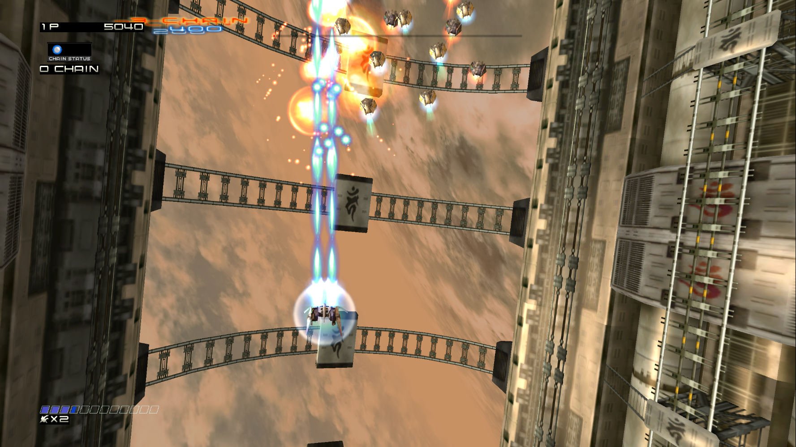
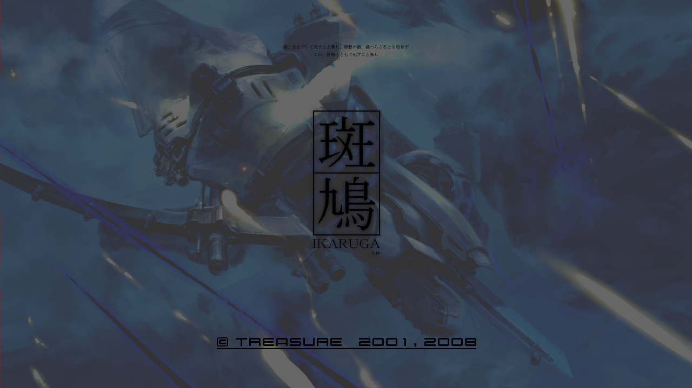
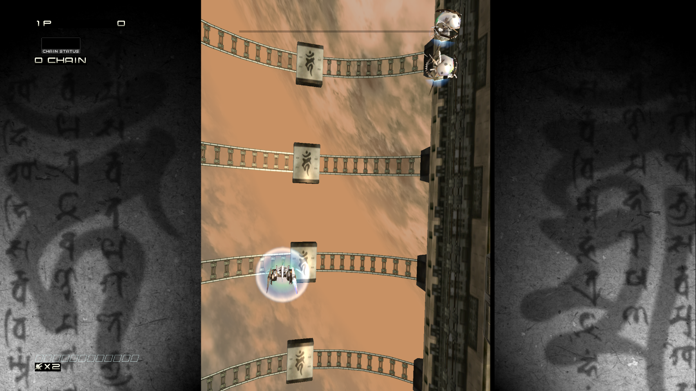

# ReKaguraX

**Ikaruga (Xbox Live Arcade) recompilé nativement pour PC Windows, Linux et Steam Deck.**

ReKaguraX ne contient **aucune donnée ni aucun code du jeu**. Vous fournissez le paquet LIVE d'Ikaruga que vous avez
acheté et copié depuis votre propre Xbox 360 ; le programme d'installation le vérifie, puis traduit le code PowerPC et
les shaders Xenos en un exécutable natif (Vulkan), directement sur votre machine.



| Écran titre | Rendu d'origine (4:3) en 1440p |
|---|---|
|  |  |

## Points forts

- Exécutable natif x86-64 : le code PowerPC du jeu est recompilé en C++ ([XenonRecomp](https://github.com/hedge-dev/XenonRecomp)),
  les shaders en SPIR-V ([XenosRecomp](https://github.com/hedge-dev/XenosRecomp)) ; rendu Vulkan, son XMA via FFmpeg.
- 60 images/s partout, haute résolution, 16:9 et 16:10 (Steam Deck).
- **Mode large** : le champ de jeu s'étend sur tout l'écran au lieu des bandes latérales décoratives.
- Réglages en jeu avec **F1** (enregistrés dans `ikaruga.ini`), sauvegardes dans `saves/`.
- Steam Deck : 60 img/s pour environ 10 W.

## Installation

Il vous faut le **paquet LIVE d'Ikaruga** (Title ID `58410878`) : un fichier sans extension que l'on trouve sur le
disque de la console dans `Content/<profil>/58410878/000D0000/`. Seule la version XBLA mondiale est acceptée
(`default.xex` SHA-1 `38357af38b21db2997dcffcd1ac5d78e7b48291d`).

### Windows

1. Téléchargez `ReKaguraX-communaute-setup.exe` depuis la page [Releases](../../releases) et installez-le.
2. À la fin, l'assistant **rkx-setup** demande votre paquet : il l'extrait, le vérifie et recompile le jeu
   (environ 3 minutes).
3. Lancez **Ikaruga** depuis le menu Démarrer.

### Linux / Steam Deck

1. Téléchargez `ReKaguraX-linux.tar.xz` depuis [Releases](../../releases) et décompressez-le où vous voulez.
2. Lancez `./rkx-setup` et choisissez votre paquet (de 1 à 3 minutes selon la machine).
3. Lancez `./ikaruga`. Sur Steam Deck, ajoutez-le à Steam comme « jeu non-Steam » pour y jouer en mode Jeu.

Rien à installer, aucun droit administrateur : le kit apporte son propre compilateur (clang) et fonctionne sur toute
distribution à glibc ≥ 2.31 (SteamOS compris).

Sans interface : `rkx-setup --headless <paquet>`.

## Compiler soi-même

Prérequis : git, CMake, Ninja, clang (llvm-mingw sous Windows), Python 3, et le jeu extrait :

```bash
python tools/stfs_extract.py "<paquet LIVE>" extracted
bash setup.sh
```

`setup.sh` récupère XenonRecomp/XenosRecomp, applique les correctifs de `Xbox360Runtime/patches`, recompile le code et
les shaders, construit FFmpeg réduit au décodeur XMA puis le jeu (`build/game/ikaruga`).

Kits communautaires : `tools/make_kit.sh` (Windows, installateur Inno Setup) et `tools/linux/build_linux.sh` puis
`tools/linux/make_kit_linux.sh` (Linux portable, sysroot Debian 11). Les deux refusent d'inclure le moindre fichier du jeu.

## Organisation

| Dossier | Contenu |
|---|---|
| `Xbox360Runtime/` | runtime commun réutilisable : noyau Xbox 360 émulé, GPU Xenos → Vulkan, audio XMA, réglages |
| `game/` | partie propre à Ikaruga (point d'entrée, nom, options) |
| `config/` | configuration de XenonRecomp (helpers, tables de `switch`) |
| `tools/` | extraction STFS, assistant `rkx-setup`, scripts des kits |
| `docs/` | captures d'écran |

## Avertissement

Projet non officiel, sans lien avec Treasure ni Microsoft. Ikaruga est © Treasure 2001, 2008. Ce dépôt ne distribue
aucun élément du jeu : utilisez uniquement une copie que vous possédez légalement.

Code sous licence GPL-3.0 (voir `LICENSE`).
